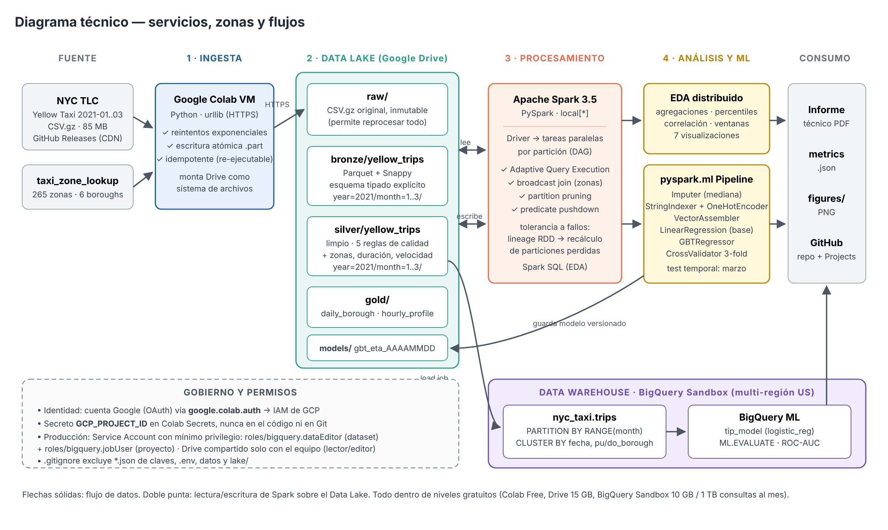

# Pipeline Big Data de Alta Disponibilidad — NYC Yellow Taxi (Q1 2021)

[](https://colab.research.google.com/github/USUARIO/bigdata-nyc-taxi-pipeline/blob/main/notebooks/pipeline_bigdata_nyc_taxi.ipynb)

**Big Data (TI3025) · Evaluación Sumativa 02** · Autor: **Ignacio Ulloa** · Docente: Paulo Simunovic Oyarzún

Pipeline completo en la nube con herramientas **Free Tier**: ingesta batch → Data Lake por zonas (Parquet particionado)
→ ETL distribuido con PySpark → Data Warehouse en BigQuery → EDA distribuido + modelo predictivo (`pyspark.ml`) + BigQuery ML.



## Resultados principales

| Indicador | Valor |
|---|---|
| Viajes ingeridos / válidos | 4.666.625 / 4.469.822 (4,22% descartado por reglas de calidad) |
| Consulta CSV.gz vs Parquet particionado | 2,07 s → 0,37 s (**5,6× más rápido**) |
| Modelo ETA (GBT, test = marzo completo, 1,85 M viajes) | **R² 0,812 · RMSE 4,16 min · MAE 2,47 min** |
| Mejora vs línea base / vs regresión lineal | −56,6% / −16,8% RMSE |
| ETA con error ≤ 5 min | 88,7% |

## Stack

| Capa | Herramienta |
|---|---|
| Ingesta (batch) | Google Colab + `urllib` (reintentos, escritura atómica, idempotente) |
| Data Lake | Google Drive: `raw` → `bronze` → `silver` → `gold` (Parquet + Snappy, `partitionBy(year, month)`) |
| Procesamiento | Apache Spark 3.5 (PySpark): AQE, broadcast join, partition pruning |
| Data Warehouse | BigQuery Sandbox: tabla particionada por mes (rango entero) y clusterizada por fecha y borough |
| ML | `pyspark.ml` (Imputer, StringIndexer, OneHotEncoder, VectorAssembler, GBTRegressor, CrossValidator) + BigQuery ML |
| Gestión | GitHub + GitHub Projects (Kanban), carta Gantt y bitácora en `docs/` |

## Estructura

```
├── notebooks/
│   ├── pipeline_bigdata_nyc_taxi.ipynb   # pipeline completo (ejecutar en Colab)
│   └── pipeline_source.py                # fuente del notebook (celdas # %%)
├── src/                                  # mismo pipeline en scripts modulares
│   ├── common.py  01_ingesta.py  02_etl.py  03_eda.py  04_modelo_ml.py  05_bigquery.py
├── config/config.yaml                    # parámetros (sin secretos)
├── results/metrics.json, results/figures/
├── docs/
│   ├── img/ (arquitectura, gantt, kanban)   diagramas.html   plan.csv   gen_gestion.py
│   ├── bitacora.md                       # roles, hitos e incidencias
│   ├── crear_kanban_github.sh            # crea issues + tablero GitHub Projects desde plan.csv
│   └── informe/ (informe.html, build_pdf.py, IUlloa.pdf)
├── requirements.txt
└── .gitignore                            # excluye datos, lake/ y credenciales
```

## Cómo ejecutar

### Opción 1 — Google Colab (recomendada)
1. Crea un proyecto en [Google Cloud](https://console.cloud.google.com) en modo **Sandbox** (sin tarjeta) y copia su *Project ID*.
2. Abre el notebook con el botón **Open in Colab**.
3. En Colab, abre **Secretos** (ícono de llave), crea `GCP_PROJECT_ID` con tu Project ID y activa el acceso al notebook.
4. Elige **Entorno de ejecución → Ejecutar todo**. Autoriza el acceso a Google Drive (Data Lake) y a Google Cloud (BigQuery) (≈ 15 min).

### Opción 2 — Scripts
```bash
pip install -r requirements.txt
cd src
python 01_ingesta.py && python 02_etl.py && python 03_eda.py && python 04_modelo_ml.py
GCP_PROJECT_ID=mi-proyecto python 05_bigquery.py     # requiere gcloud auth application-default login
```

## Gobierno y seguridad
- Autenticación con OAuth / IAM de Google (`google.colab.auth`): no hay claves en el código.
- `GCP_PROJECT_ID` se guarda en Colab Secrets o como variable de entorno.
- En producción: Service Account con `roles/bigquery.dataEditor` (dataset) + `roles/bigquery.jobUser` (proyecto).
- `.gitignore` excluye `*.json` de claves, `.env`, datos y el Data Lake.

## Dataset
NYC Taxi & Limousine Commission — Yellow Taxi Trip Records, enero a marzo de 2021 (espejo público:
[DataTalksClub/nyc-tlc-data](https://github.com/DataTalksClub/nyc-tlc-data/releases)).
